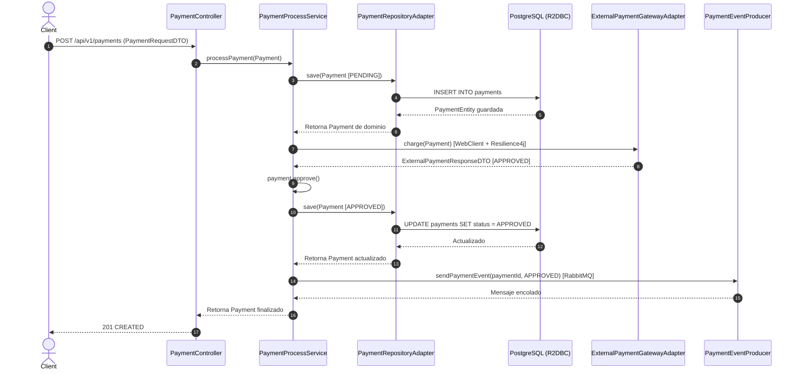
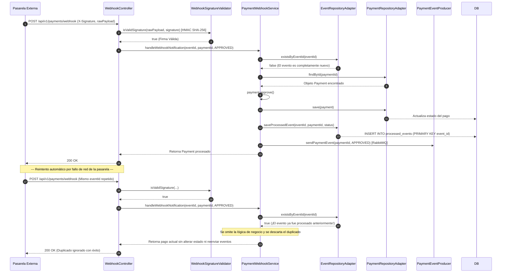

#  Payment Gateway Integration Service


Microservicio reactivo de alta disponibilidad y tolerancia a fallos para la integración con pasarelas de pago de terceros, diseñado bajo los principios de **Arquitectura Hexagonal (Ports and Adapters)**, **Spring WebFlux (R2DBC)** y patrones avanzados de ingeniería de software financiero.

---

##  Declaración de Herramientas y Justificación Tecnológica

* **Java 17 + Spring Boot 3**: Elegido por su robustez, soporte nativo de programación reactiva y rendimiento empresarial optimizado.
* **Spring WebFlux (Reactor)**: Permite procesamiento asíncrono y no bloqueante de entrada/salida (`Mono`/`Flux`), esencial para manejar picos masivos de concurrencia de clientes y webhooks sin agotar hilos del sistema.
* **Spring Data R2DBC + PostgreSQL**: Conexión reactiva nativa a base de datos relacionales. Se justifica para evitar bloqueos de hilos JDBC tradicionales y mantener la consistencia ACID con PostgreSQL.
* **Flyway**: Herramienta estándar de control de versiones y migraciones automatizadas de bases de datos (`V1__create_payments_table.sql`, `V2__create_processed_events_table.sql`).


* **Resilience4j**: Proveedor de resiliencia modular (`CircuitBreaker` y `Retry`) para aislar fallos de la pasarela de pagos externa.


* **Spring AMQP (RabbitMQ)**: Broker de mensajes para desacoplar el procesamiento de eventos de negocio asíncronos posteriores.


* **HMAC SHA-256**: Estándar criptográfico para la validación de la autenticidad e integridad de las peticiones webhook firmadas.


---

##  Supuestos Realizados

1. **Concurrencia Masiva e Idempotencia**: Suponiendo que la plataforma puede recibir múltiples reintentos simultáneos de webhooks por fallos de red de la pasarela, se implementó una tabla dedicada (`processed_events`) con el `event_id` como clave primaria en PostgreSQL, evitando condiciones de carrera a nivel de motor de base de datos.


2. **Trazabilidad y Observabilidad**: Se implementó una estrategia inicial basada en logs estructurados con identificadores de correlación (`@Slf4j`). Para un entorno de producción masivo, se asume que estos logs se centralizarán en servicios como AWS CloudWatch o Elasticsearch/Redis para auditoría y análisis forense.
3. **Disponibilidad de la Pasarela Externa**: Se asume que la pasarela de terceros puede experimentar intermitencias o latencias elevadas, por lo que se implementaron políticas estrictas de reintentos (`Retry`) y circuitos abiertos (`CircuitBreaker`).


4. **Modelo de Consistencia de Eventos**: Se asume que los eventos de notificación de webhooks pueden llegar desordenados o duplicados, por lo que la máquina de estados del dominio (`Payment`) valida estrictamente las transiciones permitidas (ej. no se puede rechazar un pago ya aprobado).


---

##  1. Arquitectura y Componentes (Arquitectura Hexagonal)

El sistema aísla por completo el núcleo de negocio de los adaptadores tecnológicos externos, estructurándose de la siguiente manera:

```
                  [ Inbound Adapters ]
   (PaymentController, WebhookController, PaymentEventConsumer)
                         │
                         ▼
                [ Inbound Ports ]
           (ProcessPaymentUseCase, etc.)
                         │
                         ▼
             [ Domain Core / Business ]
         (Payment, PaymentStatus, Exceptions)
                         │
            ┌────────────┴────────────┐
            ▼                         ▼
   [ Outbound Ports ]        [ Outbound Ports ]
 (PaymentRepositoryPort)   (EventRepositoryPort, ExternalGateway)
            │                         │
            ▼                         ▼
  [ Outbound Adapters ]     [ Outbound Adapters ]
(R2DBC / PostgreSQL)      (WebClient / RabbitMQ)

```

###  Responsabilidades por Componente y Capas

* **Capa de Dominio (`com.payment.gateway.domain`)**:
* `Payment.java`: Entidad de dominio pura que encapsula las reglas de negocio y la máquina de estados de las transacciones (`approve()`, `reject()`, etc.).


* `PaymentStatus.java`: Enumeración con los estados del ciclo de vida (`PENDING`, `APPROVED`, `REJECTED`, `FAILED`).


* `InvalidPaymentStateException.java`: Excepción controlada ante violaciones de transición de estados.


* *Puertos (Ports)*:
* `ProcessPaymentUseCase.java`: Puerto de entrada para el caso de uso de pagos.


* `PaymentRepositoryPort.java` & `EventRepositoryPort.java`: Puertos de salida que definen contratos de persistencia agnósticos a la base de datos.


* **Capa de Aplicación (`com.payment.gateway.application.service`)**:
* `PaymentProcessService.java`: Orquesta el flujo completo de creación, cobro externo, actualización y emisión de eventos de un pago.


* `PaymentWebhookService.java`: Controla la lógica de idempotencia por eventos y la aplicación segura de cambios de estado notificados por webhooks.


* **Capa de Infraestructura (`com.payment.gateway.infrastructure`)**:
* *Adaptadores de Entrada (Inbound / Driving)*:
* `PaymentController.java`: Expone la API REST HTTP para iniciar solicitudes de pago.


* `WebhookController.java`: Recibe notificaciones asíncronas de la pasarela.


* `PaymentEventConsumer.java`: Escucha mensajes asíncronos desde la cola de RabbitMQ.


* `WebhookSignatureValidator.java`: Valida la firma HMAC SHA-256 de los webhooks utilizando el payload crudo.


* *Adaptadores de Salida (Outbound / Driven)*:
* `ExternalPaymentGatewayAdapter.java`: Cliente reactivo (`WebClient`) protegido con Resilience4j (`CircuitBreaker` y `Retry`).


* `PaymentRepositoryAdapter.java` & `EventRepositoryAdapter.java`: Adaptadores que conectan el dominio con Spring Data R2DBC.


* `PaymentEventProducer.java`: Publica eventos de pago hacia el broker RabbitMQ.


* *Configuraciones y Persistencia*:
* Entidades de base de datos (`PaymentEntity.java`, `ProcessedEventEntity.java`).


* Migraciones Flyway (`V1__create_payments_table.sql`, `V2__create_processed_events_table.sql`).


* Configuraciones de red, seguridad y mensajería (`RabbitMQConfig.java`, `WebClientConfig.java`, `application.yml`).


---

##  2. Diagramas de Secuencia

### A. Flujo Exitoso (Creación y Procesamiento de Pago)



**Explicación en texto del Flujo Exitoso:**
El cliente realiza una petición HTTP POST al `PaymentController`. Este invoca al servicio de aplicación `PaymentProcessService`, el cual persiste el pago en estado `PENDING` utilizando el adaptador de repositorio reactivo R2DBC. A continuación, se invoca de forma no bloqueante a la pasarela externa mediante `ExternalPaymentGatewayAdapter` (protegido por Resilience4j). Si la pasarela responde con estado aprobado, el modelo de dominio actualiza su estado interno y se vuelve a persistir en la base de datos. Finalmente, se emite un evento asíncrono al broker RabbitMQ mediante `PaymentEventProducer` y se responde exitosamente al cliente.

---

### B. Flujo de Recepción de Webhook con Control de Idempotencia y Reintentos



**Explicación en texto del Flujo de Webhook e Idempotencia:**
La pasarela externa envía una notificación HTTP POST al `WebhookController`. El sistema valida la integridad y autenticidad del mensaje evaluando la firma criptográfica HMAC SHA-256 con el cuerpo crudo mediante `WebhookSignatureValidator`. Si la firma es inválida, rechaza la petición con un error `401 Unauthorized`. De lo contrario, el servicio `PaymentWebhookService` consulta la tabla exclusiva de idempotencia a través de `EventRepositoryAdapter` utilizando el `event_id`. Si el evento ya existe (`existsByEventId == true`), la notificación duplicada se descarta de inmediato sin alterar los datos financieros ni duplicar eventos en RabbitMQ. Si el evento es nuevo, se procesa la actualización del pago, se registra el `event_id` en la base de datos de forma atómica y se emite el evento de confirmación.

---

##  3. Modelo de Datos y Esquema Relacional

La persistencia se divide en dos tablas relacionales gestionadas mediante migraciones automatizadas de **Flyway** (`V1` y `V2`):

### 1. Tabla `payments`

Almacena el estado actual y los detalles comerciales de cada orden o intento de pago.

* `id` (`VARCHAR(255)`, **PK**): Identificador único del pago.


* `amount` (`NUMERIC(19, 2)`, `NOT NULL`): Monto monetario de la transacción.


* `currency` (`VARCHAR(3)`, `NOT NULL`): Código de moneda ISO (ej. COP, USD).


* `status` (`VARCHAR(50)`, `NOT NULL`): Estado actual del pago (`PENDING`, `APPROVED`, `REJECTED`, `FAILED`).


* `description` (`VARCHAR(255)`): Descripción o concepto de la transacción.


* `created_at` (`TIMESTAMP`, `NOT NULL`): Marca de tiempo exacta de creación.


* **Índices**: `idx_payments_status` sobre la columna `status` para optimizar consultas de conciliación.


### 2. Tabla `processed_events`

Tabla exclusiva dedicada estrictamente al control de **Idempotency Keys** (basada en el modelo de Wompi / Stripe).

* `event_id` (`VARCHAR(255)`, **PK**): Identificador único del evento notificado por el webhook (Idempotency Key). Al ser clave primaria, previene físicamente condiciones de carrera (*race conditions*) ante reintentos concurrentes.


* `payment_id` (`VARCHAR(255)`, `NOT NULL`): Referencia lógica al pago asociado.


* `status` (`VARCHAR(50)`, `NOT NULL`): Estado que aplicó dicho evento.


* `processed_at` (`TIMESTAMP`, `NOT NULL`): Fecha y hora de recepción y procesamiento.


* **Índices**: `idx_processed_events_payment` sobre la columna `payment_id` para trazabilidad rápida.