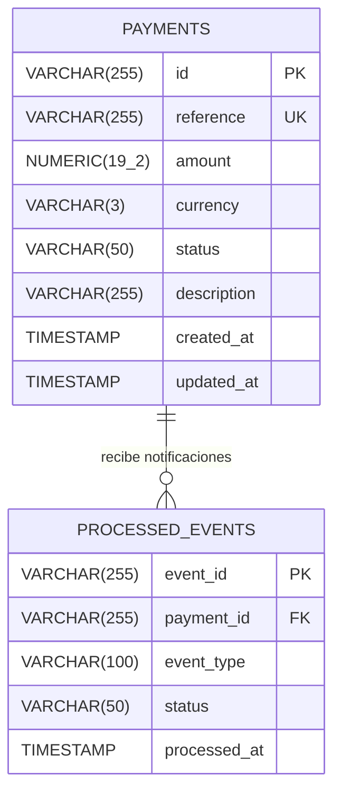
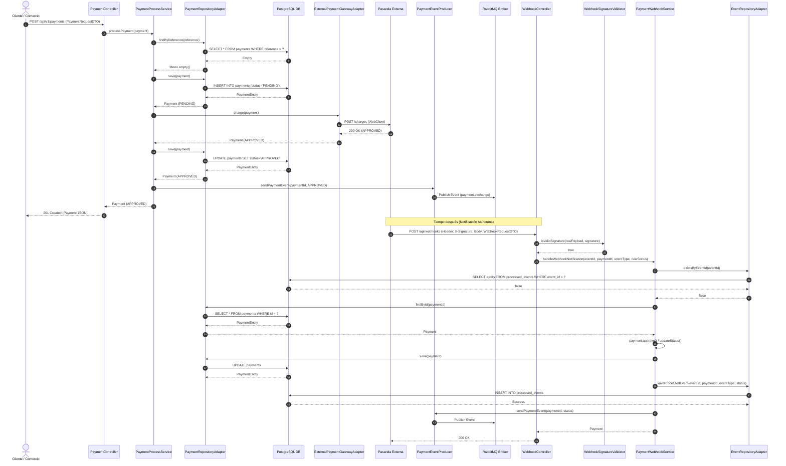
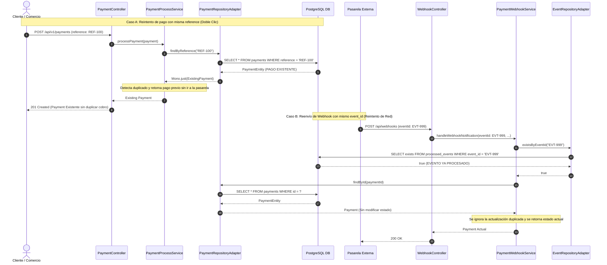

# Documentación Técnica: Solución Integración Asíncrona con Pasarela de Pagos (`payment-gateway-service`)

---

## 1. Declaración de Herramientas Utilizadas y Supuestos Realizados

### Herramientas y Frameworks Utilizados

* **Java / Spring Boot 3+ (Spring WebFlux):** Desarrollo del runtime reactivo no bloqueante.
* **Spring Data R2DBC / PostgreSQL 15:** Persistencia reactiva con driver asíncrono sobre PostgreSQL.
* **Flyway:** Gestión de migraciones de estructura DDL de base de datos en el arranque .
* **Resilience4j:** Implementación de las estrategias reactivas de *Circuit Breaker* y *Retry* con *Exponential Backoff*.
* **RabbitMQ:** Broker de mensajería orientada a eventos (*Event-Driven Architecture*) para garantizar procesamiento asíncrono desacoplado y resiliencia ante caídas de subsistemas downstream.
* **HmacSHA256:** Mecanismo criptográfico para firma e integridad de notificaciones tipo Webhook.
* **Mermaid.js:** Formato unificado para la representación legible de diagramas C4, Modelo Entidad-Relación y Diagramas de Secuencia.

### Supuestos de Diseño Realizados

1. **Supuesto de Concurrencia y Escalabilidad Horizontal:** Se asume que el sistema operará bajo altos volúmenes de tráfico concorrente y múltiples instancias del microservicio desplegadas tras un balanceador de carga. Por esta razón, la idempotencia no se delega en memoria local (`ConcurrentHashMap`), sino a nivel transaccional en PostgreSQL (`UNIQUE INDEX`) para peticiones de creación y mediante tabla de eventos deduplicados (`processed_events`) para Webhooks.
2. **Supuesto de Observabilidad y Trazabilidad Centralizada:** Para la versión actual del código se manejan logs estructurados con SLF4J/Logback enriquecidos. En un entorno de producción productivo de alta concurrencia (como AWS/GCP), se asume que estos logs estructurados serán ingeridos por un agente ( AWS CloudWatch, Datadog, etc).
3. **Supuesto sobre el Protocolo del Proveedor Externo:** Se asume que el proveedor externo soporta un modelo híbrido: consumo síncrono mediante REST API para el intento de cobro inicial y confirmación asíncrona diferida vía notificaciones HTTP POST (Webhooks) protegidos por firma HMAC-SHA256 en el encabezado `X-Signature`.
4. **Supuesto de Tolerancia a Fallos:** Supuesto de Tolerancia a Fallos y Conciliación Periódica (Scheduler)
Se asume que la pasarela externa o los consumidores downstream pueden experimentar caídas temporales de minutos u horas, así como escenarios donde la pasarela externa falle definitivamente al entregar una notificación asíncrona (Webhook) o esta se pierda por problemas de red. Para mitigar esto en un entorno productivo de alta disponibilidad, se debe implementar un servicio programado (Scheduler) que consulte activamente los endpoints de consulta de la pasarela para rescatar órdenes huérfanas en estado PENDING y asegurar la consistencia eventual de los datos

---

## 2. Arquitectura de Software y Componentes

El proyecto aplica **Arquitectura Hexagonal (Puertos y Adaptadores)** para aislar la lógica del dominio de las tecnologías de infraestructura (frameworks, bases de datos y colas).

### Diagrama de Arquitectura Hexagonal y Capas

```mermaid
graph TB
    subgraph Adaptadores_Entrada["Capas de Infraestructura: Adaptadores de Entrada (Inbound Adapters)"]
        REST_Ctrl["PaymentController<br/>(REST API)"]
        WH_Ctrl["WebhookController<br/>(Webhook Listener)"]
        Consumer["PaymentEventConsumer<br/>(RabbitMQ Consumer)"]
    end

    subgraph Puertos_Entrada["Capa de Aplicación: Puertos de Entrada (Inbound Ports)"]
        ProcessUC["ProcessPaymentUseCase<br/>(Interfaz)"]
    end

    subgraph Capa_Dominio["Capa de Dominio (Domain Core)"]
        PaymentModel["Payment<br/>(Aggregate / Model)"]
        PaymentStat["PaymentStatus<br/>(Enum)"]
        InvalidException["InvalidPaymentStateException<br/>(Domain Exception)"]
    end

    subgraph Capa_Aplicacion["Capa de Aplicación (Application Services)"]
        PaymentProcSvc["PaymentProcessService"]
        PaymentWHSvc["PaymentWebhookService"]
    end

    subgraph Puertos_Salida["Capa de Aplicación: Puertos de Salida (Outbound Ports)"]
        PaymentRepoPort["PaymentRepositoryPort<br/>(Interfaz)"]
        EventRepoPort["EventRepositoryPort<br/>(Interfaz)"]
        ExtGatewayPort["ExternalPaymentGatewayPort<br/>(Interfaz)"]
    end

    subgraph Adaptadores_Salida["Capas de Infraestructura: Adaptadores de Salida (Outbound Adapters)"]
        PaymentRepoAdapter["PaymentRepositoryAdapter"]
        EventRepoAdapter["EventRepositoryAdapter"]
        ExtGatewayAdapter["ExternalPaymentGatewayAdapter"]
        EventProducer["PaymentEventProducer"]
        SpringDataPayment["SpringDataPaymentRepository"]
        SpringDataEvent["SpringDataProcessedEventRepository"]
        WebClientBean["WebClient"]
        RabbitTemplateBean["RabbitTemplate"]
        SecurityValidator["WebhookSignatureValidator"]
    end

    subgraph Componentes_Externos["Infraestructura Externa"]
        PostgreSQL[("PostgreSQL DB<br/>(R2DBC / Flyway)")]
        ExtAPI["Pasarela Externa de Pagos<br/>(REST API)"]
        RabbitMQBroker["RabbitMQ Broker"]
    end

    %% Relaciones de Capas
    REST_Ctrl --> ProcessUC
    WH_Ctrl --> SecurityValidator
    WH_Ctrl --> PaymentWHSvc
    
    PaymentProcSvc -.-> ProcessUC
    
    PaymentProcSvc --> PaymentModel
    PaymentWHSvc --> PaymentModel
    PaymentModel --> InvalidException
    PaymentModel --> PaymentStat

    PaymentProcSvc --> PaymentRepoPort
    PaymentProcSvc --> ExtGatewayPort
    PaymentProcSvc --> EventProducer

    PaymentWHSvc --> PaymentRepoPort
    PaymentWHSvc --> EventRepoPort
    PaymentWHSvc --> EventProducer

    PaymentRepoAdapter -.-> PaymentRepoPort
    EventRepoAdapter -.-> EventRepoPort
    ExtGatewayAdapter -.-> ExtGatewayPort

    PaymentRepoAdapter --> SpringDataPayment
    EventRepoAdapter --> SpringDataEvent
    ExtGatewayAdapter --> WebClientBean
    EventProducer --> RabbitTemplateBean
    Consumer --> RabbitMQBroker

    SpringDataPayment --> PostgreSQL
    SpringDataEvent --> PostgreSQL
    WebClientBean --> ExtAPI
    RabbitTemplateBean --> RabbitMQBroker

```

---

## 3. Responsabilidades por Componente y Desglose de Capas

A continuación se detalla la ubicación en la arquitectura hexagonal y la responsabilidad de cada uno de los archivos principales del proyecto:

| Capa Hexagonal | Archivo / Componente | Responsabilidad Técnica Principal |
| --- | --- | --- |
| **Dominio** | `Payment.java` | Agregado de Dominio. Contiene el estado del pago, las fechas de creación/actualización y encapsula las reglas de transición de estado (`approve()`, `reject()`, `updateStatus()`). |
| **Dominio** | `PaymentStatus.java` | Enum de dominio con los estados válidos: `PENDING`, `APPROVED`, `REJECTED`, `FAILED`. |
| **Dominio** | `InvalidPaymentStateException.java` | Excepción explícita de negocio lanzada si se intenta una transición de estado inválida (ej. rechazar un pago previamente aprobado). |
| **Aplicación (Inbound Ports)** | `ProcessPaymentUseCase.java` | Interfaz que define el contrato de entrada para la orquestación del flujo de procesamiento de pago. |
| **Aplicación (Outbound Ports)** | `PaymentRepositoryPort.java` | Contrato para la persistencia y consulta de pagos (`save`, `findById`, `findByReference`). |
| **Aplicación (Outbound Ports)** | `EventRepositoryPort.java` | Contrato para verificar la existencia de eventos procesados y registrarlos (`existsByEventId`, `saveProcessedEvent`). |
| **Aplicación (Outbound Ports)** | `ExternalPaymentGatewayPort.java` | Contrato abstracto para el cobro síncrono contra la pasarela externa. |
| **Aplicación (Services)** | `PaymentProcessService.java` | Orquestador de creación de pagos. Valida la existencia previa por `reference`, guarda el registro en estado `PENDING`, ejecuta la llamada a la pasarela externa y notifica a RabbitMQ de manera asíncrona. |
| **Aplicación (Services)** | `PaymentWebhookService.java` | Orquestador del webhook. Garantiza la idempotencia mediante la consulta de `eventId` en `processed_events`, actualiza el estado del pago en la BD y publica la actualización en RabbitMQ. |
| **Infraestructura (Inbound)** | `PaymentController.java` | Adaptador REST controlador HTTP. Mapea la petición recibida a DTO y delega al caso de uso de aplicación. |
| **Infraestructura (Inbound)** | `WebhookController.java` | Endpoint receptor de notificaciones asíncronas de la pasarela. Invoca la validación de firma y envía el payload a `PaymentWebhookService`. |
| **Infraestructura (Inbound)** | `PaymentEventConsumer.java` | Consumidor AMQP (`@RabbitListener`) que procesa los eventos publicados en la cola de RabbitMQ. |
| **Infraestructura (Security)** | `WebhookSignatureValidator.java` | Componente criptográfico que recalcula la firma HMAC-SHA256 usando el payload crudo y la clave secreta compartida para validar contra la cabecera `X-Signature`. |
| **Infraestructura (Outbound)** | `ExternalPaymentGatewayAdapter.java` | Adaptador HTTP reactivo (`WebClient`). Integra la pasarela externa aplicando Resiliencia reactiva con Resilience4j (*Circuit Breaker* y *Retry*). |
| **Infraestructura (Outbound)** | `PaymentRepositoryAdapter.java` | Adaptador de persistencia. Mapea la entidad de dominio `Payment` a la entidad R2DBC `PaymentEntity` y delega en Spring Data. |
| **Infraestructura (Outbound)** | `EventRepositoryAdapter.java` | Adaptador de persistencia para el registro y auditoría de eventos de webhook procesados (`ProcessedEventEntity`). |
| **Infraestructura (Outbound)** | `PaymentEventProducer.java` | Adaptador de mensajería que usa `RabbitTemplate` para emitir eventos en JSON hacia el Topic Exchange de RabbitMQ. |
| **Infraestructura (Config/Persistence)** | `application.yml`, `V1...sql`, `V2...sql` | Configuraciones de R2DBC, Resilience4j y scripts Flyway con tablas e índices únicos y compuestos. |

---

## 4. Modelo de Datos y Optimización de Índices

### Diagrama Entidad-Relación (Mermaid)

### Justificación de los Índices de Base de Datos

1. `idx_payments_reference` **(Unique Index en `payments.reference`):**
* **Propósito:** Cada transacción financiera está asociada a un código de referencia interno generado por el comercio.
* **Justificación:** Previene a nivel de motor de base de datos la creación de dos transacciones paralelas con la misma referencia en situaciones de peticiones HTTP duplicadas o reintentos del cliente, garantizando la consistencia ante condiciones de carrera.

2. `idx_payments_status_created` **(Compound Index en `payments(status, created_at)`):**
* **Propósito:** Soporta consultas eficientes orientadas a conciliación o tareas batch programadas.
* **Justificación:** Consultas del estilo *"Obtener pagos en estado PENDING creados hace más de 2 horas"* son ejecutadas frecuentemente por procesos de fondo. Este índice evita un escaneo secuencial masivo de la tabla (*Sequential Scan*), optimizando las I/O de la base de datos.

3. `idx_processed_events_payment` **y** `idx_processed_events_type_date` **en `processed_events`:**
* **Propósito:** Indexación de la tabla de auditoría de notificaciones recibidas.
* **Justificación:** Permiten auditorías instantáneas sobre la frecuencia y timestamps de notificaciones enviadas por la pasarela para un mismo pago. Facilitan la resolución de disputas transaccionales y la trazabilidad operativa.

---

## 5. Idempotencia y Resiliencia en Detalle

En la integración con pasarelas de pago conviven dos entornos con responsabilidades e identidades independientes: el **Cliente/Comercio** que genera la orden y la **Pasarela Externa** que procesa y notifica la transacción.

### Resumen de Mecanismos de Idempotencia

| Mecanismo | Nivel de Capa | Actor Origen | Problema Específico que Previene |
| --- | --- | --- | --- |
| **`reference` + Unique Index** | `PaymentProcessService` / PostgreSQL DB | Cliente o Comercio | Evita que un doble clic en la interfaz de usuario o un reintento de red cree **dos órdenes o cobros distintos** para una misma compra. |
| **`event_id` + Tabla `processed_events**` | `PaymentWebhookService` / PostgreSQL DB | Pasarela Externa | Evita que un reintento del Webhook por fallos en el ACK del protocolo HTTP altere dos veces el estado del pago o genere eventos duplicados en la cola. |

---

### Explicación del Mecanismo de Firma de Seguridad en Webhooks

Las notificaciones de webhooks están expuestas en un endpoint público. Para evitar que terceros maliciosos envíen peticiones falsas para marcar un pago como `APPROVED`, se implementa `WebhookSignatureValidator`:

1. La pasarela comparte una clave secreta (`payment.gateway.webhook.secret-key`).
2. Al enviar la notificación, la pasarela firma el payload JSON usando el algoritmo **HMAC-SHA256** y lo adjunta en el encabezado HTTP `X-Signature`.
3. El controlador `WebhookController` recibe el payload *raw* sin modificar y la firma enviada.
4. `WebhookSignatureValidator` recalcula la firma criptográfica localmente en base al secreto y al payload raw recibido.
5. Si la firma calculada no coincide exactamente byte a byte con la firma recibida, la solicitud se rechaza inmediatamente con una excepción de seguridad, impidiendo la manipulación o falsificación de estados.

---

### Política de Reintentos, Circuit Breaker y Garantías con RabbitMQ

#### 1. Tolerancia a Fallos en Llamadas Salientes (`ExternalPaymentGatewayAdapter`)

* **Retry con Exponential Backoff:** Configurado mediante Resilience4j para tolerar caídas o parpadeos de red transitorios (`TimeoutException`, `ServiceUnavailable`, `GatewayTimeout`). Realiza un máximo de 3 intentos espaciados exponencialmente (2s, 4s), impidiendo saturar a la pasarela externa.
* **Circuit Breaker:** Monitorea una ventana deslizante de las últimas 10 peticiones. Si el 50% o más de las llamadas fallan o tardan más de 3 segundos, el circuito pasa a estado `OPEN` durante 10 segundos. Durante este período, las peticiones fallan rápido (*fail-fast*), desviándose al flujo de fallback y evitando la acumulación excesiva de hilos o recursos reactivos retenidos.

#### 2. Procesamiento Asíncrono Resiliente con RabbitMQ

* **Desacoplamiento:** Cuando el estado de un pago cambia en `PaymentProcessService` o `PaymentWebhookService`, se publica un evento en RabbitMQ en un hilo elástico no bloqueante.
* **Persistencia y Resiliencia:** La cola `payment.webhook.queue` está configurada como durable (`durable = true`). Si los microservicios downstream (notificaciones, conciliación, contabilidad) se encuentran fuera de línea o sufren fallos, RabbitMQ retiene de forma persistente los mensajes. Una vez que los servicios se restablecen, el consumidor (`PaymentEventConsumer`) procesa automáticamente todos los mensajes acumulados, garantizando consistencia eventual y entrega de información sin pérdidas.

---

## 6. Diagramas de Secuencia

### Diagrama 1: Flujo Exitoso Completo (Creación y Procesamiento de Webhook)

Este diagrama abarca el ciclo de vida completo: la creación del pago por parte del cliente, la comunicación síncrona con la pasarela y la confirmación posterior por Webhook.

#### Explicación del Diagrama 1:

1. El cliente envía la solicitud REST. Se verifica mediante `findByReference` que la orden no haya sido registrada previamente.
2. Se guarda la orden en estado `PENDING` y se delega el cobro al puerto `ExternalPaymentGatewayPort`.
3. `ExternalPaymentGatewayAdapter` realiza el llamado HTTP a la pasarela externa de forma no bloqueante.
4. Al recibir confirmación, actualiza el estado en la base de datos y publica un evento en RabbitMQ.
5. Cuando la pasarela remite el Webhook de actualización, `WebhookController` valida la cabecera HMAC `X-Signature`.
6. `PaymentWebhookService` comprueba que el `eventId` no exista en `processed_events` (garantizando idempotencia), persiste el evento y notifica a los suscriptores a través de RabbitMQ.

---

### Diagrama 2: Manejo de Excepciones (Idempotencia en Webhook Duplicado y Intento de Pago Repetido)

Este diagrama ilustra las dos barreras de seguridad ante peticiones duplicadas provenientes del cliente (reintento de creación) o de la pasarela (webhook duplicado).

#### Explicación del Diagrama 2:

1. **Caso A (Cliente - Doble Clic):** Al recibir una solicitud con una referencia ya registrada (`reference`), la consulta `findByReference` rescata la entidad existente. El servicio retorna el pago actual de forma idempotente sin invocar la pasarela externa ni realizar duplicaciones de saldo.
2. **Caso B (Pasarela Externa - Webhook Duplicado):** Si la pasarela reenvía una notificación con un `eventId` que ya fue guardado previamente en `processed_events`, `existsByEventId` retorna `true`. El sistema ignora la actualización de estado, no emite eventos duplicados hacia RabbitMQ y responde HTTP 200 OK a la pasarela para confirmar la recepción sin alterar los datos.

---

## 7. Selección y Justificación Tecnológica

| Tecnología | Elección concreta | Justificación técnica |
|---|---|---|
| **Runtime y framework** | Java / Spring Boot 3+ (Spring WebFlux) | Permite construir una arquitectura reactiva y no bloqueante sobre Netty. Es adecuado para aplicaciones de pasarelas de pago que manejan múltiples conexiones concurrentes y operaciones de I/O de red, como las llamadas a pasarelas externas. Puede reducir la necesidad de hilos en espera frente a un modelo tradicional bloqueante, siempre que se utilicen componentes no bloqueantes de extremo a extremo. |
| **Persistencia asíncrona** | Spring Data R2DBC / PostgreSQL 15 | R2DBC proporciona acceso reactivo y no bloqueante a PostgreSQL. Evita que las consultas a la base de datos bloqueen los hilos que gestionan el flujo reactivo, manteniendo la reactividad desde el controlador hasta la persistencia. |
| **Migraciones de base de datos** | Flyway | Permite versionar y controlar los cambios del esquema de la base de datos, incluidas tablas, restricciones e índices únicos o compuestos. Puede ejecutar las migraciones automáticamente durante el arranque de la aplicación mediante JDBC, sin requerir que las operaciones de negocio utilicen JDBC. |
| **Resiliencia y tolerancia a fallos** | Resilience4j | Proporciona mecanismos como Circuit Breaker y Retry, con integración para Reactor mediante operadores como `CircuitBreakerOperator` y `RetryOperator`. Permite aislar fallos temporales de la pasarela externa y configurar reintentos con *exponential backoff*. Los reintentos deben limitarse a operaciones que puedan repetirse de forma segura, utilizando idempotencia para evitar cobros duplicados. |
| **Broker de mensajería** | RabbitMQ | Implementa un modelo de mensajería asíncrona que desacopla los componentes mediante eventos. Con una configuración adecuada de colas durables, mensajes persistentes y confirmaciones de publicación y consumo, permite implementar una estrategia de entrega *At-Least-Once*. Los consumidores deben ser idempotentes para gestionar posibles entregas duplicadas y recuperarse de fallos temporales. |
| **Seguridad e integridad** | HMAC-SHA256 | Permite verificar la autenticidad e integridad de los webhooks mediante una firma calculada con una clave secreta compartida. La aplicación compara la firma recibida con la calculada sobre el contenido de la solicitud, siguiendo el mecanismo definido por la pasarela. Para evitar ataques de repetición, también debe validar la marca de tiempo o el identificador del evento cuando el proveedor lo admita. |
